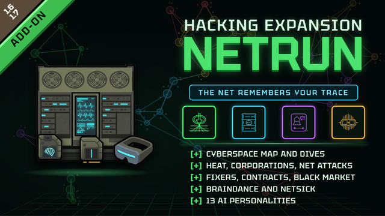

# Hacking Expansion: Netrun

  

  
  
  
  
  

  <b>English</b> | <a href="README_RU.md">Русский</a>

---

> *"The network remembers your trace. Data is currency, but the netrunner pays in body and sanity."*

**Hacking Expansion: Netrun** is a deep cyberpunk expansion layer for RimWorld 1.6, designed as a modular companion to **[Ushanka's Hacking Expansion](https://steamcommunity.com/sharedfiles/filedetails/?id=3573344880)**.

Intrusions are no longer isolated events: every breach leaves a digital trace across remote nodes, attracts underworld fixers, awakens autonomous network AIs, and provokes severe corporate counter-intrusion protocols.

---

## ⚡ Overview

**Hacking Expansion: Netrun** transforms hacking in RimWorld into a high-stakes cat-and-mouse dynamic:

**Infiltration → Cyberdata Harvest → Digital Heat → Network Retaliation (ICE, Net Attacks, Mercenaries)**

* **The Network Remembers:** The more telemetry you generate, the deadlier the network's response.
* **Data as Currency:** Trade stolen archives for hardware, hire fixers, and scrub your trace clean.
* **The Cost of Cybernetics:** Long-term cyberspace immersion causes neural degradation (Netsick) and addiction.

---

## 🚀 Key Features

### 1. Digital Heat & Network Trace
Every intrusion or data siphon generates measurable telemetry for the colony (0–100%).
* **Shadow (0–24%):** Undetected ghost presence. Networks remain passive.
* **Noticed (25–49%):** Security alerts tripped. Slight neuro-noise and data theft risks.
* **Tracked (50–74%):** Active triangulation. Viral machine breakdowns, battery power grid spikes.
* **Target (75–89%):** High-priority threat. Corporate ransomware, mercenary strike deployment.
* **Red Zone (90–100%):** Maximum alert. Lethal black-ops raids, rogue AI flight or hijacking risks.

Trace passively cools down over time or can be actively expunged through underworld fixers using Cyberdata.

### 2. Underworld Fixers & Rogue Contracts
Access the Network Terminal via the comms console to tap into an ever-rotating roster of fixers:
* **Specializations:**
  * **Broker** — Buys bulk data archives at a premium payout (x1.5).
  * **Cleaner** — Quickly and cheaply purges colony Heat from remote tracking nodes.
  * **Fence** — Delivers rare cybernetic equipment and modules via orbital drop-pods.
* **Personality Traits:** Fixers can be *Reliable*, *Greedy*, or hidden *Rats* (who may sell out your coordinates upon failed contracts).
* **Contracts:** Time-sensitive missions for system penetrations, secure data deliveries, and stealth ops without tripping trace thresholds.

### 3. Autonomous Network AIs (13 Personalities)
Dormant AI fragments can be salvaged from protected systems and awakened at the network console:
* **Infrastructure:**
  * **AI Server (2×2):** Dedicated computing facility running core services (requires 300W power).
  * **Server Racks:** Modular server extensions expanding colony capacity up to 3 active AI cores.
  * **Netrun Coprocessor:** Cyberpod attachment that houses an AI to dampen Heat buildup and slow Netsick.
  * **AI Socket:** Neural cranial implant allowing direct embodiment of an AI inside a colonist's brain.
* **Personalities:**
  * *Ghost* — Dampens Heat and provides early warning telemetry.
  * *Data Hunter* — Siphons bonus Cyberdata from network runs.
  * *Muse* — Inspires colonists and accelerates research progress.
  * *Predator* — Neutralizes network attacks and boosts host combat prowess.
  * *Warden* — Autonomous firewall guarding against ICE feedback shocks.
  * *Doc* — Accelerated nervous system recovery from cybernetic trauma.
  * *Oracle* — Forecasts upcoming events and reveals fixer hidden traits.
  * *Trickster*, *Siren*, *Echo (Fallen Hacker)*, *Seed*, *Forge*, *Archivist*.
* **Trust & Hunger:** Each core has unique desires. Starved or mistreated AIs can leak coordinates, defect, or trigger host mental overrides.

### 4. Braindance (BD Recording & Chips)
Complete closed-loop synthesis of virtual neural recordings:
* **Braindance Goggles:** Worn on the eyes. Passively captures raw emotional peaks (combat victories, joy, trauma) into a `Raw BD Recording`.
* **Console Editing:** Raw recordings are edited at the network console into finished BD chips of varying quality (*Normal, Excellent, Masterwork*).
* **Playback:** Requires BD goggles or an installed Cyberlink neural interface. Grants intense mood elevation but carries real addictive danger.

### 5. Network Incidents & "The Black Book"
* **Network Attacks:** Hacker neuro-noise, remote cyberdata theft, machine sabotage, power surges, and ransomware lockouts.
* **The Black Book:** A covert mercenary syndicate without static map bases. Deploys elite hit-squads tracing hot telemetry signals or retaliating for botched contracts.

### 6. Cyberspace Sickness (Netsick)
Excessive pod immersion leads to chronic cyberspace dependency. Severe withdrawal can trigger erratic binges where netrunners recklessly dive into the net: 65% chance of brain trauma or coma, but 12% chance of a legendary breakthrough with rare data and AI fragments.

---

## 📦 Requirements & Load Order

1. **RimWorld 1.6**
2. **Harmony**
3. **Vanilla Expanded Framework**
4. **Ushanka's Hacking Expansion**
5. **Hacking Expansion: Netrun** *(must load after Hacking Expansion)*

---

## 📜 Authors & Credits

* **Lead Developer & Art:** GafarovMaxim
* **Special Thanks:** BlueEagle421 & the Ushanka Modding Team for the incredible foundation of Hacking Expansion.

# Hacking Expansion: Netrun

  <a href="README.md">English</a> | <b>Русский</b>

---

> *«Сеть помнит твой цифровой след. Данные стоят денег, но расплачиваться приходится рассудком и телом нетраннера».*

**Hacking Expansion: Netrun** — это модульное киберпанк-расширение для RimWorld 1.6 в стилистике Уильяма Гибсона и Cyberpunk. Мод разработан как глубокая сюжетно-механическая надстройка для **[Ushanka's Hacking Expansion](https://steamcommunity.com/sharedfiles/filedetails/?id=3573344880)**.

Взлом больше не является изолированным действием: каждое вторжение оставляет след в сети, привлекает внимание фиксеров теневого рынка, пробуждает автономные ИИ и вызывает ответную реакцию корпоративных систем защиты.

---

## ⚡ О моде

**Hacking Expansion: Netrun** превращает взлом в RimWorld в полноценную игру кошки-мышки с корпоративными узлами и подпольным миром:

**Взлом → Данные (Cyberdata) → Цифровой след (Heat) → Ответ сети (ICE, атаки, наёмники)**

* **Сеть помнит твой почерк:** чем больше данных вы качаете, тем опаснее ответная реакция.
* **Данные — это валюта:** покупка софта, найм фиксеров и отмывание следа.
* **Нетраннер платит телом и разумом:** развитие сетевой болезни (Netsick) и риск комы при срывах.

---

## 🚀 Ключевые механики

### 1. Цифровой след (Digital Heat)
Каждая операция взлома повышает общий след колонии в сети (0–100%).
* **Тень (0–24%):** Полная скрытность, сеть не реагирует.
* **Замечен (25–49%):** Системы настороже, лёгкий нейрошум и риск кражи данных.
* **Отслеживается (50–74%):** Активная пеленгация, вирусные поломки станков, скачки энергии в аккумуляторах.
* **Цель (75–89%):** Атаки корпоративных вымогателей, подготовка штурмовых групп.
* **Красная зона (90–100%):** Максимальная тревога, карательные рейды наёмников, риск побега ИИ.

След медленно остывает со временем либо экстренно сбрасывается через фиксеров за Cyberdata.

### 2. Подпольные фиксеры и контракты
Терминал на консоли связи открывает доступ к меняющемуся пулу связных:
* **Специализации:**
  * **Брокер** — скупает массивы данных с повышенной наградой (x1.5).
  * **Чистильщик** — эффективно и со скидкой стирает цифровой след.
  * **Скупщик** — поставляет редкое кибероборудование и модули дроп-подами.
* **Черты характера:** фиксеры бывают *Надёжными*, *Жадными* или скрытыми *Крысами* (могут сдать колонию при провале сделки).
* **Контракты:** срочные заказы на взлом целей, доставку шифров или «тихий заход» без превышения следа.

### 3. Автономные сетевые ИИ (13 личностей)
Осколки спящего кода пробуждаются на консоли связи и размещаются в колонии:
* **Где живут:**
  * **ИИ-Сервер (2×2):** основной вычислительный центр колонии (требует 300 Вт питания).
  * **Серверные стойки:** модульное расширение серверной до 3 активных ядер.
  * **Сопроцессор Netrun:** модуль у кибер-капсулы, снижающий нагрев Heat и тормозящий развитие зависимости.
  * **ИИ-Сокет:** имплант в мозг пешки для прямой интеграции личности ИИ в колониста.
* **Личности:**
  * *Ghost (Призрак)* — сбивает след Heat и предупреждает об угрозах.
  * *Data Hunter (Охотник)* — приносит дополнительные массивы Cyberdata.
  * *Muse (Муза)* — дарует озарения и вдохновляет колонистов.
  * *Predator (Хищник)* — отражает сетевые атаки, повышает боевые навыки носителя.
  * *Warden (Страж)* — автоматический фаервол и защита от ICE-отдачи.
  * *Doc (Врач)* — ускоренное восстановление нервной системы после взломов.
  * *Oracle (Оракул)* — предсказывает события и вскрывает черты фиксеров.
  * *Trickster (Трикстер)*, *Siren (Сирена)*, *Echo (Эхо погибшего)*, *Seed (Зерно)*, *Forge (Кузнец)*, *Archivist (Архивариус)*.
* **Доверие и Голод:** у каждого ядра свои потребности. Голодный или обиженный ИИ может уйти в сеть, саботировать базу или устроить ментальный оверрайд носителю.

### 4. Брейнданс (Braindance)
Полный цикл создания и воспроизведения виртуальных переживаний:
* **Брейнданс-очки:** надеваются на глаза. Пассивно записывают яркие эмоции колониста (победа в бою, экстаз, пережитый ужас) в виде «сырой записи».
* **Монтаж на консоли:** сырая запись монтируется в обычный или чёрный BD-чип разного качества (обычное, отличное, мастерское).
* **Воспроизведение:** доступно только в очках или с установленным кибер-линком. Даёт мощный эмоциональный подъем, но вызывает привыкание.

### 5. Сетевые угрозы и «Чёрная книга»
* **Атаки сети:** нейрошум у хакеров, удалённая кража накопленных данных, поломка станков, скачки напряжения и вымогатели.
* **Наёмники «Чёрной книги»:** скрытый синдикат без постоянных баз. Высылает элитные ударные отряды по свежему цифровому следу или при предательстве фиксеров.

### 6. Сетевая болезнь (Netsick)
Регулярные погружения в капсулу вызывают зависимость. При сильной ломке колонист может не выдержать и самовольно ринуться в сеть: в 65% случаев это заканчивается комой или травмой, но в 12% — легендарным прорывом с редкими данными и осколками ИИ.

---

## 📦 Требования и порядок загрузки

1. **RimWorld 1.6**
2. **Harmony**
3. **Vanilla Expanded Framework**
4. **Ushanka's Hacking Expansion**
5. **Hacking Expansion: Netrun** *(загружать после Hacking Expansion)*

---

## 📜 Авторы и благодарности

* **Автор:** GafarovMaxim
* **Особая благодарность:** BlueEagle421 и команде Ushanka Modding Team за отличную базу Hacking Expansion.

